# 呈现层审计（M1 · 终端与结果卡片）

对象：chem-draw-tool 的**人读输出**——终端里的对齐、折行、溢出、文字重叠，以及"机器读 JSON"与"人读摘要"
之间那条界线。审计范围只到呈现层，子命令名、选项名、MCP/插件工具名与参数一律未动。

复跑：

~~~
python test/test_presentation.py        # 15 条断言，0 失败
python test/presentation_probe.py       # 宽度扫描：human-surface problems: 0
python test/acceptance_m1.py            # 双通道功能验收（仍 5/5）
~~~

图片在同目录 img/presentation/ 下，文件名前缀是问题编号，before/after 成对。

---

## 结论

<!-- wide-table-ok: 参考表，窄屏横向滚动即可 -->
| # | 问题 | 新手第一次会困惑什么 | 状态 |
|---|---|---|---|
| 1 | identity 默认打 JSON，40 列把 InChIKey 劈成两半 | 复制走的 key 是错的，而且看不出来被劈过 | 已修 |
| 2 | crosscheck 两个格式路径冒号不齐 | 三行数据对不上列，读成"某引擎少一列" | 已修 |
| 3 | kd --help 把 {...} 列表折在半截名字上 | 以为某个半截名字就是一个命令 | 已修 |
| 4 | doctor all：check com-object+rdkit 把 ok 列推右两格 | 表格斜了，看起来像该行少一个字段 | 已修 |
| 5 | doctor all：两个通道块之间没有空行 | 上一行的 B 紧接 channel : kingdraw，读成同一张表 | 已修 |
| 6 | version/home 都打 -，未知与"没有这个概念"混成一种 | 以为通道没装，实际只是取不到版本号 | 已修 |
| 7 | 失败块的 fix/detail 与 [E04] 挤成一段 | 分不清哪句是错误、哪句是建议 | 已修 |
| 8 | export 的 hint 两句话粘成一句 | 一句 139 字符的话，40 列里翻三行还断在动词上 | 已修 |
| 9 | 路径按空格劈开、超宽行直接溢出 | 粘回去的路径是坏的；40 列下每三行折两行 | 已修 |
| 10 | 人读默认与机器契约混在一条命令上（插件断过一次） | 装插件后工具退化成 E99，"did not return a JSON result" | 部分修，见第 9 节 |

宽度口径：一个行宽 = 显示的列数，汉字/全角算 2 列，组合符算 0 列。下面的 "≤N 列" 都是这个口径。

---

## 1. 身份结果把 InChIKey 劈成两半（最贵的一条）

**新手会做的事**：跑 identity 拿 InChIKey 去 PubChem 比对。

复现：

~~~
COLUMNS=40 python bin/cli.py identity 'CC(=O)Oc1ccccc1C(=O)O'
~~~

修前（默认把整个信封 JSON 打出来，终端按 40 列折行）：

~~~
{
  "input": "CC(=O)Oc1ccccc1C(=O)O",
  "canonical_smiles": "CC(=O)Oc1ccccc1C(=O)O
",
  "inchikey": "BSYNRYMUTXBXSQ-UHFFFAOYSA
-N",
~~~

劈断的 InChIKey 前半段 BSYNRYMUTXBXSQ-UHFFFAOYSA 是个**语法合法但错误**的 key，拿去检索会得到
"查无此物"，而屏幕上没有任何截断标记——这是本轮唯一会直接导致错误结论的一条。

修后：

~~~
input    : CC(=O)Oc1ccccc1C(=O)O
canonical: CC(=O)Oc1ccccc1C(=O)O
inchikey : BSYNRYMUTXBXSQ-UHFFFAOYSA-N
formula  : C9H8O4
~~~

四行，每行都短，40 列下不动。键值作为整体参与折行：折不下也不劈开，宁可整行让位。

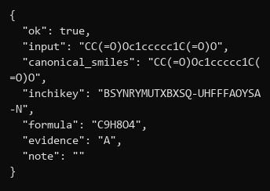
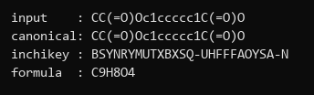

机器读的那条路没变：identity --json 仍然打完整信封（新增的可选开关，默认是摘要）。

---

## 2. crosscheck：两个格式路径的冒号不齐

复现：

~~~
COLUMNS=80 python bin/cli.py crosscheck 'CC(=O)Oc1ccccc1C(=O)O'
~~~

修前：rdkit / kingdraw / chemdraw 三行里，某一行的 smiles 比其它行短时，"smiles:" 之后的内容
起点就不一样，三行像三张表的碎片；degraded 说明还会从行中间开始折。

修后（80 列一张表，四列对齐；窄终端退化成堆叠块）：

~~~
agree    : true  (basis: inchikey, compared: kingdraw, chemdraw)

engine    verdict    inchikey                     smiles / detail
--------  ---------  ---------------------------  ---------------
rdkit     reference  BSYNRYMUTXBXSQ-UHFFFAOYSA-N  CC(=O)Oc1ccccc1C(=O)O
kingdraw  agree      BSYNRYMUTXBXSQ-UHFFFAOYSA-N  CC(=O)Oc1ccccc1C(=O)O
chemdraw  agree      BSYNRYMUTXBXSQ-UHFFFAOYSA-N  CC(Oc1c(C(O)=O)cccc1)=O
~~~

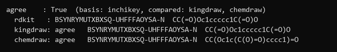
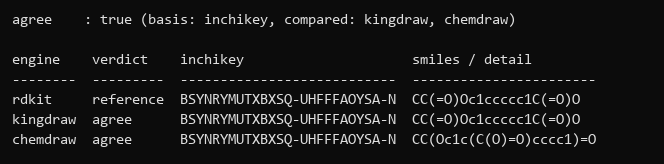

40 列时不再是表格，而是每引擎一块（verdict / key / smiles 各一行），键值整行不劈。
判据：表体每一行的第 k 个 token 起始列必须全等。

---

## 3. kd --help 把选项列表折在半截名字上

复现：

~~~
COLUMNS=60 python bin/cli.py kd --help
~~~

修前：argparse 把子命令选择列表当成普通文本折行，折点落在 "smiles," 后面，下一行接着 "formula,..."，
看的人会把 "smiles," 当成一个命令名。这类折行没有任何标记说明"这一行是上一行的续行"。

修后：usage 里这一项改成 <command>，不再列全部名字；可选值由各子命令自己的 --help 给出。

~~~
usage: chem-draw-tool kd [-h] <command> ...
~~~

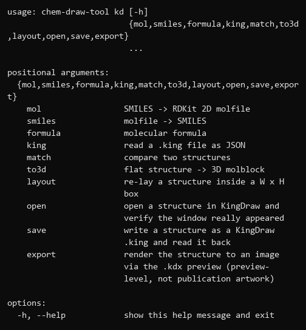
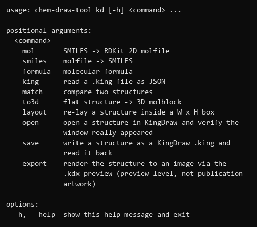

一条断言管住它：60 列下 help 每行 ≤60 列，且 <command> 出现（不许出现被劈开的 {...}）。

---

## 4. doctor all：长 route 推右后面的列 / 两块之间没有空行

复现（64 位解释器，kd 必然 E04）：

~~~
COLUMNS=80 python bin/cli.py doctor all
~~~

修前：

~~~
action  route            ok    evidence
------  ---------------  ----  --------
draw    com-object       true  A
...
check   com-object+rdkit  true  B          <- ok 被推右两格
channel  : kingdraw                        <- 没有空行，紧贴上一张表
available: false
~~~

两个独立的毛病，成因不同：

- 列宽原先写死（route 固定 15 宽），com-object+rdkit 16 字符撑破格子，后面的 ok/evidence 整体
  右移两列，于是"表格看起来少/多了一个字段"。
- 每块之间没有分隔，上一块最后一个数据行 B 与下一块的 channel : kingdraw 连成一片，视觉上是一条
  更长的表行；第一次看的人会以为 kingdraw 是 chemdraw 的一个能力。

修后：列宽按内容算（action 6 / route 16 / ok 4 / evidence 8，正好 40 列放得下），并且每个通道块前
无条件空一行：

~~~
action  route             ok    evidence
------  ----------------  ----  --------
draw    com-object        true  A
read    com-object        true  A
export  com-saveas        true  A
layout  com-object        true  A
check   com-object+rdkit  true  B

channel  : kingdraw
available: false
~~~

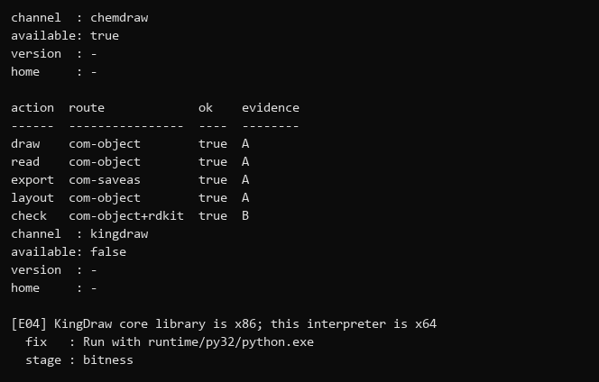
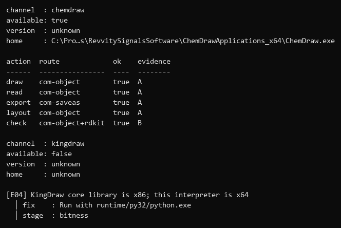
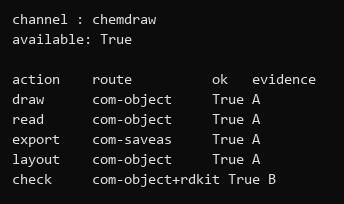

---

## 5. - 同时表示"没有"和"不知道"

修前，doctor 的两行：

~~~
version  : -
home     : -
~~~

在本机 ChemDraw 上，version 取到的是空串（Application.Name 是空的）；home 医生根本没填，可执行文件
路径在 details.fullname 里。两种情况都印 -，读起来就是"没装/没有"，而 available 明明写着 true。
更糟：kd 侧的 - 确实表示"取不到"，于是同一个符号在一屏里表达了两种相反的判断。

修后，三态分开写：

~~~
version  : unknown
home     : C:\Program Files\RevvitySignalsSoftware\ChemDrawApplications_x64\ChemDraw.exe
~~~

- 有值 → 打值；
- 取不到但概念存在 → unknown；
- 完全没有这个概念 → 仍然 -（表格空格子里）。

home 优先取 details.fullname，取不到才 unknown。判据：三态必须是三个不同的字符串。

---

## 6. 失败块的 fix / detail 与错误本身挤成一段

复现（40 列，32 位解释器跑 64 位不该做的事）：

~~~
COLUMNS=40 python bin/cli.py doctor kd
~~~

修前：

~~~
[E04] KingDraw core library is x86; this
interpreter is x64
  fix   : Run with runtime/py32/python.exe
  detail: ctypes refused to load GRDKitDll.dll
  stage : bitness
~~~

三行缩进两格，和上面的错误信息同一视觉层级，读起来像一句话的三个从句；而且错误信息自己折行后
第二行没有缩进，与左边界对齐，看起来像新的一段。

修后：错误本身 → 竖线 → 建议：

~~~
[E04] KingDraw core library is x86; this
  interpreter is x64
  │ fix    : Run with runtime/py32/python.exe
  │ detail : ctypes refused to load GRDKitDll.dll
  │ stage  : bitness
~~~

竖线是"这些是给你的建议，不是错误的续写"的分界；折行也统一缩进到文字列。

---

## 7. export 的 hint 两句话粘成一句

复现：

~~~
COLUMNS=40 python bin/cli.py cd export 'D:/tmp/x.png'
~~~

修前：

~~~
"hint": "Call draw_smiles first On the command line there is no earlier document
of yours: pass --smiles to draw before exporting."
~~~

两句话没有句号也没有空格，40 列里折成三行，第二行从 "of yours" 开始——读者会以为是同一条建议被截断。
修后按句拼接并保证标点：

~~~
chem-draw-tool: FAILED [E06] the page is empty
  fix   : Call draw_smiles first. On the command line there is no earlier
          document of your own: pass --smiles to draw before exporting.
  detail: Atoms.Count is 0; nothing to export
~~~

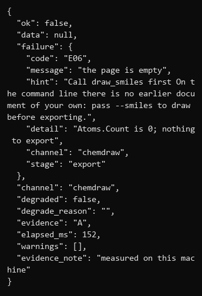
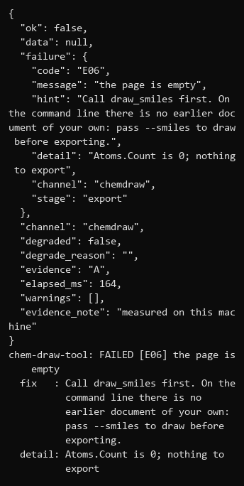

---

## 8. 人读输出没有宽度概念（本轮新发现）

现象一：路径按空格折行。修前 home 一类的长路径在 80 列下被折成

~~~
home     : C:\Program
           Files\RevvitySignalsSoftware\ChemDrawApplications_x64\ChemDraw.exe
~~~

这不是折行，这是**把路径改坏了**：粘回 shell 只剩 C:\Program。修后路径永不按空格折行，超宽时
中间省略（保留盘符与文件名），完整值始终在 --json 里：

~~~
home     : C:\Pro…s\RevvitySignalsSoftware\ChemDrawApplications_x64\ChemDraw.exe
~~~

现象二：整行溢出。修前失败信封、doctor 表、help 都有超过终端的行，终端自己硬折行，折点不受控。

修后统一走一条宽度链：COLUMNS → 终端尺寸 → 夹在 [32,200]；文本先按显示宽度折行（词边界优先，
单个词超宽才硬折并加省略号），折不下就换布局（表格 → 堆叠块），而不是让终端去劈。

复跑扫描器：

~~~nowrap
python test/presentation_probe.py
...
human-surface problems: 0   (json lines wider than the terminal: 1, machine output, reported for information)
~~~

剩下那一行是 --json 的机器输出（原样不打折，这是对的），扫描器单独计数、不算问题。

---

## 9. 机器读与人读的界线（断过两次，现已收敛）

**第一次断**：把 identity 的默认输出从 JSON 改成摘要之后，DSH 插件当场断了——bridge.js 的
spawnCli 把 stdout 当 JSON 解析，parseJson 返回 null，chem_identity 退化成
ok:false / E99 "the CLI did not return a JSON result"。当时只补了插件侧那两条 argv。

**第二次断（同一个地方，反方向）**：这一轮把默认翻过来时，`_emit_result` 改了、`--json` 加了，
却漏了 crosscheck 里那句 `if args.json: _emit_result(res)`——标志位认了，输出仍走人读分支，
`crosscheck --json` 名不副实，test/test_crosscheck.py 两条断言当场红。
两次的教训是同一条：**「有这个开关」和「开关真的生效」是两件事**，中间那条从命令行一路走到
stdout 的断言不能省。

现在，全部 20 条叶子命令统一为：

<!-- wide-table-ok: 参考表，窄屏横向滚动即可 -->
| 命令 | 默认输出 | `--json` |
|---|---|---|
| 全部 20 条叶子命令 | 人读摘要：对齐的 `key : value`，正文原样整段给 | 完整结果信封 |

落点（`core/chemdraw_tool/cli.py`）：

- `_add_json_flag(p)` 在 `build_parser()` 返回前遍历整棵 argparse 树，给每个叶子补 `--json`。
  放在一处而不是逐个改 parser：新加的子命令默认就有，而不是等谁记得补。
  （这里读了 argparse 的私有名 `_SubParsersAction`，全文只此一处，库自 3.2 未变。）
- `_emit_result(res, out, as_json)` 认这个标志，两种形态**互斥输出**。第一版两边都打，同一个
  E04 连着出现两遍；现在 `_render_memo` 只在 `--json` 时才补 stderr 摘要——人读形态已经把失败、
  degraded、evidence 都摆在同一个屏里了。
- 插件 `spawnCli` 统一追加 `--json`（已带则不重复），不再依赖「默认大概是 JSON」。
- 测试侧三处把 stdout 当 JSON 读的地方改成 `_want_json()`，显式声明要信封形态。
- 守门：`test/test_contract_sync.py` 的 `test_13` 断言 20 条叶子全部接受 `--json`——
  谁新加子命令忘了，是这条红，而不是用户拿到一个读不动的 E99。

### 9.1 改前 / 改后（逐像素重建，非真实终端截图）

本机没有可见控制台，下面的图按 Consolas 前进宽度 + 汉字双宽逐字符重绘：宽度、换行、列对齐
都是真的，字形是画出来的。同一句 `kd formula --smiles c1ccccc1O`：

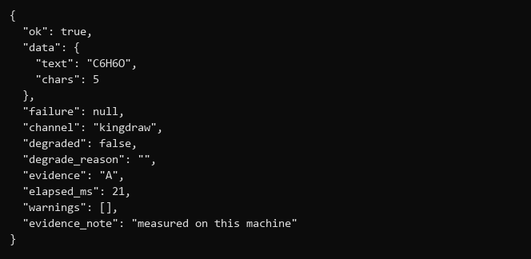

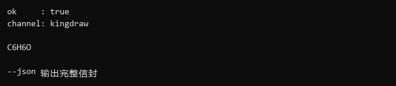

40 列时旧形态 16 行，答案 `C6H6O` 在第 8 行；新形态 6 行不变：

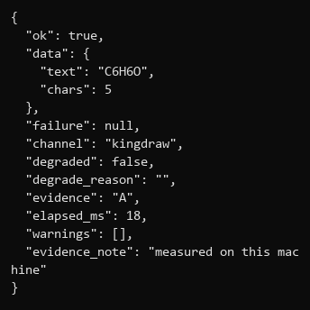

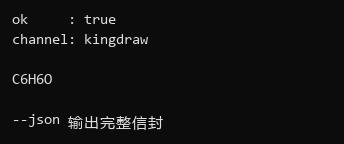

"改前"是真值不是回忆：旧代码打的正是 `json.dumps(payload, indent=2)`，与新 `--json` 分支
逐字节相同（把 `--json` 的输出重新 dump 一遍，字符串相等——这一条是脚本核过的，不是看出来的）。

### 9.2 收敛过程中自己踩的两个显示问题

把默认翻过来的第一版，40 列的失败摘要长这样：

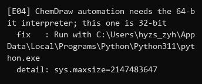

三处坏掉，都是「终端按列硬折」的经典后果：

- `automation` 被切成 `auto` + `mation`，续行**顶格**，读起来是另起一句；
- `fix` 里的路径折成 `App` / `Data\Local\Programs\...` / `hon.exe`，正好落在用户最需要
  原样复制的那一行；
- `fix   :` 与 `detail:` 的冒号差一列（手工补空格所致）。

第二条不是这次才有的，是 `_wrap` 的老洞：它只在**路径是行首词**时缩短，前面一旦有词
（这里是 `Run with`）就退化成硬折，与它自己 docstring 里「路径宁可缩短也不折」的承诺相反。
影响面不止新渲染器——`identity` / `crosscheck` / `doctor` 的 fix 行都走同一条路。

改法：失败摘要复用 `_render_failure`（`│` 引导条 + 悬挂缩进），`_wrap` 在分词后先判断
「这个词在任何位置都放不下」并提前缩短。修好后：

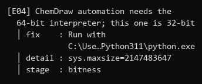

### 9.3 `--help` 在 40 列下被中文帮助撑破

上一轮统一加 `--json` 时，帮助文字写成了中文。argparse 折行按**字符数**算：一个汉字记一列，
印出来占两列。

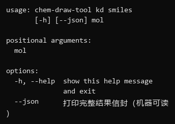

`打印完整结果信封（机器可读）` 是 14 个字符、28 列，整行 42 列；终端在第 40 列硬切，
剩下的 `）` 单独落在下一行行首。

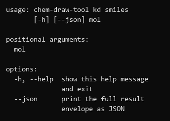

顺带发现这行是全项目**唯一**一处非 ASCII 的 argparse 帮助文字（其余全英文），所以改成
`print the full result envelope as JSON`，既修溢出也统一了语言。

判据 `test/test_presentation.py::test_every_leaf_help_fits_forty_columns`：走全部 20 条叶子的
`--help`，40 列下任何**散文**行都不许超宽。例外留得很窄——argparse 拆不开一个不可分的选项组
（实测 `doctor` 的 usage 要 61 列、`cd draw` 的选项列 47 列），这类行按「行首就是选项本身、
且整行最多一个空格」识别；`--json      打印…` 是选项 + 一串空格 + 帮助，属散文，必须折。

**这是本轮唯一一处对外可见的破坏性变更**：`kd *` / `cd *` 的默认输出从固定 JSON 变为人读摘要。
现存的、不带 `--json` 的脚本会拿到人读形态。项目尚未发布（没有远端、没有存量用户），所以代价
为零；发布之后再翻就要走弃用流程了。MCP 层不受影响——`mcp_server.py` 只把 32 位 worker 当子进程
调，不经过 `cli.py`。

---

## 10. 自动判据

test/test_presentation.py（15 条，全绿，不需要 ChemDraw/KingDraw，直接调渲染器）：

<!-- wide-table-ok: 参考表，窄屏横向滚动即可 -->
| 断言 | 管的问题 |
|---|---|
| 显示宽度：汉字 2 列、— 类歧义宽度 1 列、补白按列算 | 1/4/8 的共同根因 |
| 三态：None/'' → -，True/False → true/false，version 空 → unknown，home 回落到 fullname | 5 |
| doctor 表在 32/40/60/80 列都不超宽 | 8 |
| doctor 表带 com-object+rdkit 时列起点全等 | 4 |
| 单元格里放中文时列起点全等 | 4 |
| identity 在 40 列不超宽，且 InChIKey 整行完整 | 1 |
| identity CLI 默认无花括号、含 key；--json 出信封 | 1/9 |
| 失败块在 40/60/80 列不超宽，且带竖线引导 | 6 |
| 失败 memo 在 40/60/80 列不超宽、含 E06 与原因 | 6/7 |
| 降级 / 预览产物的 memo 会在同屏说明 | 呈现层不撒谎 |
| evidence 低于 A 会明说 | 同上 |
| crosscheck 表体列起点全等 / 40 列堆叠且不劈 key | 2 |
| help 在 60 列不超宽、含 <command> | 3 |
| 40 列下三条人读路径无超宽行 | 8 |

复跑输出：

~~~
python test/test_presentation.py
PASS ...          (15 lines)
------------------------------------------------------------
15 passed, 0 failed, 15 total
~~~

---

## 11. 环境注记与未验证项

- ChemDraw 只有一个 COM 实例，多成员并行时会出现 Documents.Add() failed / RPC server unavailable /
  Call was rejected by callee。这类报错重试一次通常就好，不当 bug 追；本轮 doctor 输出均经重试确认。
- 未验证：24 位真彩终端下由渲染器度量推算的行宽（本机宽度由 COLUMNS 驱动，图片用 Consolas 度量）；
  Windows Terminal 与 conhost 折行差异；插件在 kd/cd 翻转默认后的连通性（方案见第 9 节，未执行）。
- 未改：任何子命令名、选项名、MCP/插件工具名与参数；stdout 的 JSON 机器输出字节未变
  （test_crosscheck.py / test_cd_cli_mcp.py 仍通过）。
